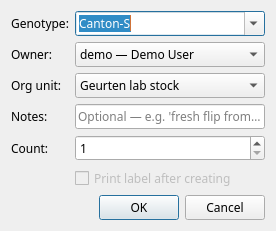
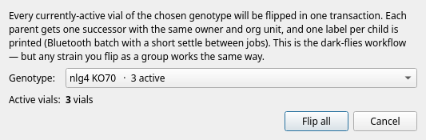
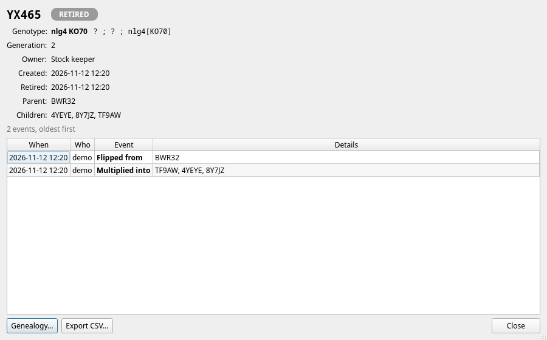
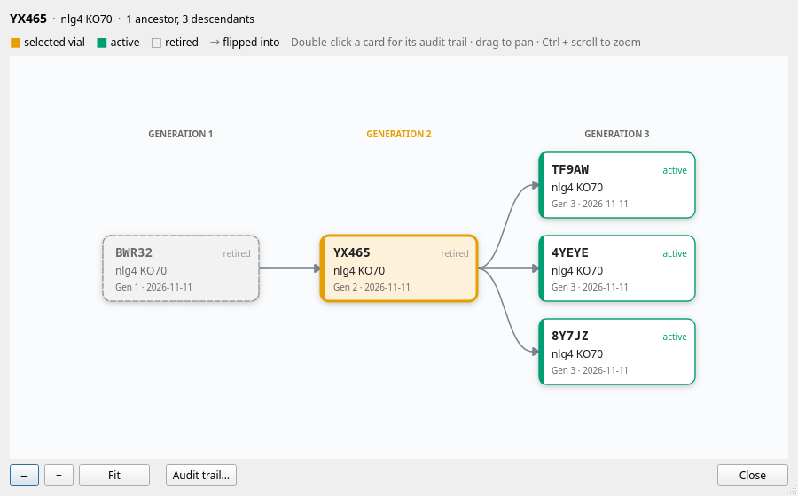
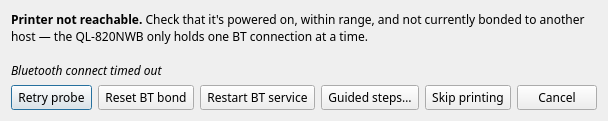
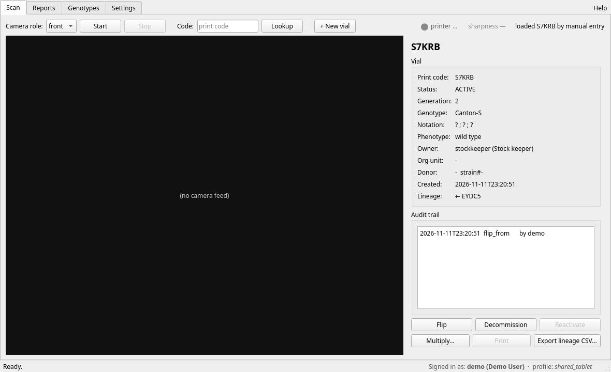
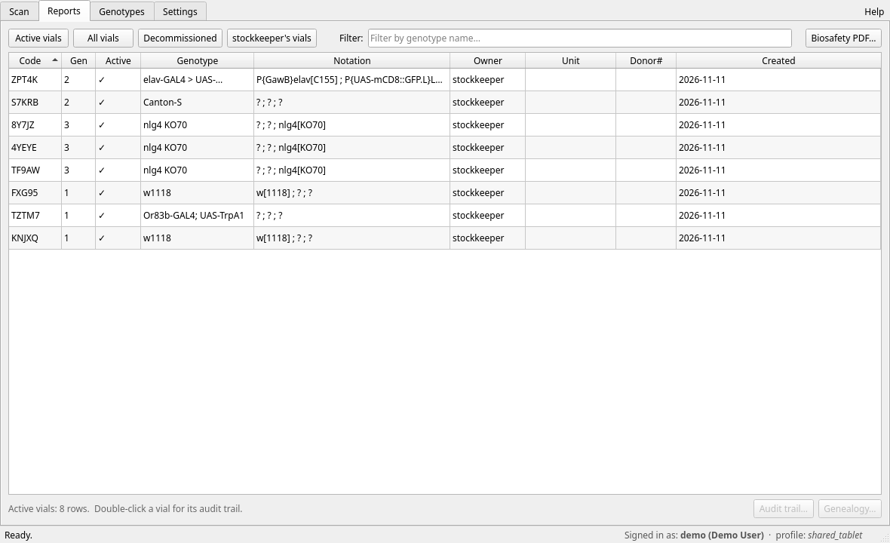
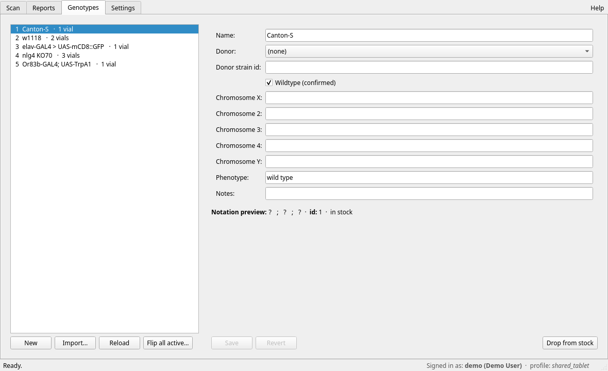
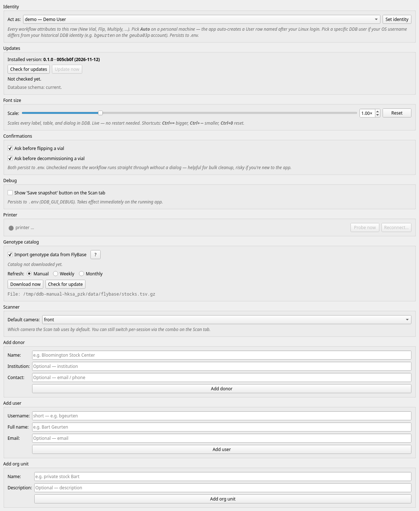

# DDB user manual

DDB keeps track of every fly vial in the lab. Each vial carries a small
label with a QR code and a five-character **print code** (for example
`GWN78`). Scan the label and DDB shows you what is in the vial, where it
came from and what has happened to it. Flip it, and DDB retires the old
vial, creates its successor and prints the new label.

This manual has three parts:

- [Getting started](#getting-started): opening DDB, the window, and the words DDB uses.
- [Everyday tasks](#everyday-tasks): step-by-step instructions for the jobs you do at the bench.
- A reference section for each tab ([Scan](#scan-tab), [Reports](#reports-tab),
  [Genotypes](#genotypes-tab), [Settings](#settings-tab)) describing every
  button. Press **F1** on any tab, or click **Help** in the top-right
  corner, to jump straight to that tab's section.

## Getting started

### Opening DDB

Each person on the lab tablet has their own login and their own copy of
DDB, but everyone shares one vial database. Log in as yourself, then
either double-click the **DDB** icon on the desktop, or press the Super
(Windows) key, type `DDB` and press Enter. To keep DDB in the dock,
right-click its icon there and choose **Pin to Dash**.

> **Tip:** The first time you double-click the desktop icon, Ubuntu may
> ask whether to trust it. Right-click it and choose **Allow Launching**.

Everything you do is recorded under your name. The bottom-right corner
of the window shows who DDB thinks you are ("Signed in as: …"). If that
is wrong, fix it under [Settings → Identity](#settings-tab) before you
flip anything.

### The main window

The window has four tabs:

| Tab | What it is for |
|---|---|
| **Scan** | Scan a label (or type its code), see the vial, and flip, multiply, decommission or reprint it. Create new vials. |
| **Reports** | Lists of vials, each vial's history and family tree, and the biosafety report. |
| **Genotypes** | The lab's genotypes: add, import, edit, drop from stock, and flip every vial of a genotype at once. |
| **Settings** | Who you are, updates, text size, confirmations, printer, FlyBase catalog, cameras, and adding donors, users and org units. |

The status bar along the bottom shows short messages on the left
("Ready.") and, on the right, who you are signed in as. When a newer
version of DDB is available it also shows **Update available** there; see
[Updating DDB](#updating-ddb).

Whenever a dialog opens, the window behind it dims so you can see which
window is waiting for you.

**Keyboard shortcuts**

| Keys | Action |
|---|---|
| F1 | Open this manual at the current tab's section |
| Ctrl + = (or Ctrl + +) | Larger text |
| Ctrl + - | Smaller text |
| Ctrl + 0 | Reset text size |

In this manual window, Ctrl + F jumps to the search box, F3 finds the
next match and Esc closes the window. The manual window stays open beside
DDB while you work.

### Words DDB uses

| Word | Meaning |
|---|---|
| **Print code** | The five-character code on every label, such as `GWN78`. It uses digits and capital letters, but never I, L, O or U, so it can't be confused with 1 or 0. The QR code contains the same code. |
| **Active / decommissioned** | An active vial is in use on the shelf. A decommissioned vial is retired: it stays in the database with its full history but can no longer be flipped. The history and family-tree views call it **retired**. |
| **Flip** | Move the flies to a fresh vial. DDB retires the old vial and creates one successor with the same genotype, owner and org unit, one generation later. |
| **Multiply** | Flip one vial into 2 to 12 fresh vials at once. |
| **Flip all** | Flip every active vial of one genotype in one go. |
| **Generation (Gen)** | Starts at 1 for a new vial and goes up by one with every flip. |
| **Genotype** | The fly line, with its chromosomes, phenotype and donor. |
| **In stock / dropped** | Whether the lab still keeps a genotype. Dropped genotypes stay in the database for the record but no longer appear when you create vials. |
| **Notation** | The genotype written chromosome by chromosome: `X ; II ; III`, with IV added if filled in. A `?` means that chromosome was not recorded. |
| **Donor** | Where a line came from (for example the Bloomington Stock Center), with that donor's own stock number. |
| **Owner** | The person a vial belongs to. |
| **Org unit** | The group a vial belongs to, such as the lab's stock collection or a private stock. |
| **Audit trail** | The list of everything that ever happened to a vial: who did what, and when. |
| **Genealogy** | A vial's family tree: the vials it was flipped from and the vials flipped from it. |

## Everyday tasks

### Creating vials and printing labels

1. On the **Scan** tab, click **+ New vial**.
2. **Genotype:** start typing any part of the name and pick it from the
   list. You can also type the donor's stock number (for example `9405`).
   Only genotypes that are in stock appear.
3. Check **Owner:** (you, by default) and **Org unit:**.
4. **Notes:** is optional, for example "fresh flip from stock".
5. **Count:** how many vials to create at once (1 to 96). Each one gets
   its own print code and label.
6. Leave **Print label after creating** ticked to print straight away.
   It is greyed out when the printer is switched off for your account.
7. Click **OK**. DDB creates the vials, prints the labels one after the
   other, and shows the last new vial on the Scan tab.

While labels are printing, DDB doesn't respond to clicks; wait until the
last label is out. If some labels fail, DDB says how many, and you can
[reprint them](#reprinting-a-label) later.

### Scanning a label

1. On the **Scan** tab, choose the camera under **Camera role:** and
   click **Start**.
2. Hold the label inside the four green corner marks, about 30 to 50 cm
   from the camera. The **sharpness** number next to the printer light
   turns green (above 300) when the picture is sharp enough.
3. When DDB reads the code it chimes and shows the vial on the right.
4. Click **Stop** when you are done.

If a label won't scan, type its code into the **Code:** box and press
Enter (or click **Lookup**). Upper or lower case doesn't matter.

> **Tip:** "No camera assigned to role …" means this camera hasn't been
> set up for your account yet. Ask the tablet admin (see
> [Things done outside DDB](#things-done-outside-ddb)).

### Flipping a vial

1. Scan the vial (or look it up by code).
2. Click **Flip**.
3. If DDB asks "Flip vial?", check the genotype, owner and org unit the
   new vial will inherit, then click **Yes**. Tick "Don't show me this
   message again" to skip this question in future; you can switch it back
   on under [Settings → Confirmations](#settings-tab).
4. DDB retires the old vial, creates the new one and prints its label.
   The Scan tab now shows the new vial.

If the label doesn't print, the new vial still exists. Stick on a label
later by [reprinting it](#reprinting-a-label).

### Flipping all vials of a genotype

Use this when you flip a whole line at once, for example every vial of a
stock on flip day.

1. On the **Genotypes** tab, click **Flip all active…**.
2. Pick the genotype. The list shows how many active vials each one has,
   busiest first, and remembers the genotype you flipped last time.
3. Click **Flip all**, then confirm with **Yes**.
4. DDB retires every active vial of that genotype, creates one successor
   for each and prints one label per new vial. At the end it reports how
   many vials were flipped and how many labels printed.

### Multiplying a vial

Use this to split one vial into several, for example to expand a line.

1. Scan the vial and click **Multiply…**.
2. Enter how many new vials you want (2 to 12) and click **OK**.
3. DDB retires the original vial, creates the new vials (all one
   generation later, all with the original as their parent) and prints a
   label for each. The Scan tab shows the first new vial.

### Decommissioning a vial

Use this when a vial is finished and nothing replaces it: the line was
lost, the vial got mites or mould, or the experiment is over.

1. Scan the vial and click **Decommission**.
2. Type a **Reason:** if you like (for example "contaminated"). It is
   saved in the vial's audit trail.
3. Click **OK**. The vial is retired; its history is kept.

Ticking "Don't show me this message again" skips this dialog, and the
reason, in future. Switch it back on under
[Settings → Confirmations](#settings-tab).

### Reactivating a vial

If you decommissioned a vial by mistake, scan it (or look it up by code)
and click **Reactivate**. DDB asks you to confirm.

If the vial was already flipped and its successor is still active, DDB
warns you: reactivating would leave two active vials in the same line (a
"forked lineage"). That is usually not what you want, so click **No**
unless you really have both vials on the shelf.

### Reprinting a label

1. Scan the vial or type its code into **Code:**.
2. Click **Print**.

**Print** is greyed out when the printer is switched off for your account,
or when the label picture for that vial is missing. If DDB reports "Label
missing", flip the vial to get a fresh label.

### Adding a genotype by hand

1. On the **Genotypes** tab, click **New**.
2. Fill in the form: **Name:** is required; everything else is optional.
   Pick the **Donor:**, or choose "+ New donor…" and type its name to add
   one. Tick **Wildtype (confirmed)** for confirmed wild-type lines.
3. Click **OK**. DDB refuses a name that already exists, so you don't end
   up with two copies of the same line.

### Importing a genotype from FlyBase

DDB can fill in a stock-centre line for you from the FlyBase stock
catalog (Bloomington, Vienna, Kyoto and others).

1. Once only: under **Settings → Genotype catalog**, tick **Import
   genotype data from FlyBase**, then click **Download now** (about 3 MB).
2. On the **Genotypes** tab, click **Import…**.
3. Choose the stock centre under **Source:**, type the stock number under
   **ID:** and click **Lookup**.
4. Check the pre-filled form and correct anything you need.
5. Click **Create genotype**.

If the lab already has a genotype with that stock number, DDB asks what
to do: **Open existing** jumps to it, **Create duplicate** keeps a
separate copy (useful when a re-ordered stock should be kept apart from a
possibly contaminated old one) and **Abort** does nothing.

### Dropping a genotype from stock

When the lab no longer keeps a line:

1. Flip or decommission its remaining vials first. DDB won't drop a
   genotype that still has active vials, and tells you which ones.
2. On the **Genotypes** tab, select the genotype and click **Drop from
   stock**, then confirm.

The genotype stays in the database, greyed out and marked "dropped",
but no longer appears when you create vials. To bring it back, select it
and click **Re-activate**.

### Looking up a vial's history and family tree

On the **Reports** tab, double-click any vial to see its **audit trail**:
every event, oldest first, with who did it and any details, such as the
reason for a decommission. **Export CSV…** saves the list as a
spreadsheet file.

Click **Genealogy…** (on the Reports tab or in the audit trail) to see
the vial's family tree: its ancestors to the left and its descendants to
the right. The selected vial is orange, active vials are green, and
retired vials are grey with a dashed outline. Double-click any card to
see that vial's audit trail. Drag to move around, Ctrl + scroll to zoom,
and use **−**, **+** and **Fit**.

You can also right-click a vial in the Reports list for both views.

### Making the biosafety report

1. On the **Reports** tab, click **Biosafety PDF…**.
2. Choose where to save the PDF.

The report covers the last three months for the whole lab: a snapshot of
the stock, the activity during the period, active vials per owner, a
signature block, and an annex listing every genotype in stock. Reports for
other periods are made by the tablet admin.

### When the printer won't print

When DDB can't reach the label printer, it asks what to do before
printing:

- **Retry probe:** check again. Use this first, especially right after
  DDB has started: DDB hasn't checked the printer yet, so the first print
  often stops at this dialog.
- **Reset BT bond:** clear the Bluetooth pairing and try again.
- **Restart BT service:** restart the tablet's Bluetooth (asks for a
  password).
- **Guided steps…:** a four-step walk-through: switch Bluetooth off on the
  printer, wait, switch it on again, then clear the pairing.
- **Skip printing:** carry on without printing. The vials are still
  created; reprint the labels later.
- **Cancel:** stop the whole action. Nothing is created.

Also check that the printer is switched on and that no other computer or
phone is connected to it; the printer only talks to one device at a time.
The printer light on the Scan and Settings tabs shows the printer's
state: green "printer ready", red "printer error" or "printer offline",
grey when DDB hasn't checked yet or printing is switched off. Click the
light to check again.

### Updating DDB

When **Update available** appears in the status bar:

1. Go to **Settings → Updates** and click **Update now**.
2. Confirm. DDB downloads and installs the new version.
3. Restart DDB when asked.

**Check for updates** checks by hand. If **Update now** stays greyed out,
the reason appears in red underneath; ask the tablet admin. The line
"Database schema" should say "current"; anything else also needs the
admin.

## Scan tab

The Scan tab is where you work with one vial at a time.

**Top row, left to right**

- **Camera role:** which camera to scan with (front or back). Your
  default is set under [Settings → Scanner](#settings-tab).
- **Start** / **Stop:** switch the camera on and off.
- **Code:** type a print code and press Enter, or click **Lookup**, when a
  label won't scan.
- **+ New vial:** create vials and print their labels; see
  [Creating vials and printing labels](#creating-vials-and-printing-labels).
- **Save snapshot:** only shown when debug mode is on (Settings → Debug);
  saves the current camera picture for troubleshooting the scanner.
- The **printer light** shows the label printer's state; click it to check
  again.
- **Sharpness:** how sharp the camera picture is. Green (above 300) scans
  reliably, amber is borderline, red is too blurry: move the label 30 to
  50 cm away from the camera.
- On the far right, the last thing that happened, such as "last scan:
  GWN78".

**Camera picture (left).** The live picture from the camera. Hold the
label inside the green corner marks.

**Vial (right).** The vial you scanned last: print code, whether it is
active or decommissioned, generation, genotype and notation, phenotype,
owner, org unit, donor, when it was created, and its lineage (← the vial
it came from, → the vials flipped from it).

**Audit trail.** The vial's recent events, newest first. For the full,
readable history use the [Reports tab](#reports-tab).

**Buttons under the vial.** They only work once a vial is shown.

| Button | What it does | Available when |
|---|---|---|
| **Flip** | [Flip the vial](#flipping-a-vial) | the vial is active |
| **Decommission** | [Retire the vial](#decommissioning-a-vial) without a successor | the vial is active |
| **Reactivate** | [Undo a decommission](#reactivating-a-vial) | the vial is decommissioned |
| **Multiply…** | [Split the vial into 2 to 12 new vials](#multiplying-a-vial) | the vial is active |
| **Print** | [Reprint the vial's label](#reprinting-a-label) | the printer is switched on and the label exists |
| **Export lineage CSV…** | Save the vial's ancestors and descendants as a spreadsheet file | always |

## Reports tab

The Reports tab lists vials and opens each vial's history.

**Lists.** Click one of the buttons along the top:

- **Active vials:** every vial currently on the shelf (shown when DDB starts).
- **All vials:** active and retired.
- **Decommissioned:** retired vials only.
- **stockkeeper's vials:** the vials of the lab's stock keeper account (the
  button shows that account's name). This is the lab's own stock
  collection, not your personal vials.

**Filter:** type part of a genotype name to narrow the list. The list
shows the newest 500 vials; click a column heading to sort by it.

**Columns:** Code, Gen (generation), Active (✓ or —), Genotype,
Notation, Owner, Unit (org unit), Donor# (the donor's stock number) and
Created (date).

**Working with a vial in the list**

- Double-click a vial for its [audit trail](#looking-up-a-vials-history-and-family-tree).
- Select a vial, then click **Audit trail…** or **Genealogy…** at the
  bottom right.
- Right-click a vial for the same two choices.

**Biosafety PDF…** makes the [biosafety report](#making-the-biosafety-report).

## Genotypes tab

The Genotypes tab holds the lab's fly lines. The list on the left shows
each genotype with its number of active vials; dropped genotypes are grey
and marked "dropped".

**Buttons under the list**

- **New:** [add a genotype by hand](#adding-a-genotype-by-hand).
- **Import…:** [import a genotype from FlyBase](#importing-a-genotype-from-flybase).
  Only shown when the FlyBase catalog is switched on in Settings.
- **Reload:** refresh the list.
- **Flip all active…:** [flip every active vial of one genotype](#flipping-all-vials-of-a-genotype).

**The form on the right** shows the selected genotype: name, donor and
donor strain id, **Wildtype (confirmed)**, chromosomes X, 2, 3, 4 and Y,
phenotype and notes. Under the form, the notation preview shows how the
genotype will appear on labels, and whether it is in stock.

To edit a genotype, change the form and click **Save**; **Revert** throws
your changes away. Both are greyed out until you change something. Every
saved change is recorded with the old and new values.

**Drop from stock** and **Re-activate** take a genotype out of stock and
put it back; see [Dropping a genotype from stock](#dropping-a-genotype-from-stock).

## Settings tab

Settings marked *(your own)* apply only to your login; the others change
the shared database for everyone.

**Identity** *(your own).* **Act as:** chooses which DDB user your work is
recorded under. "Auto" uses your login name, which is right for most
people. Pick a specific user only if your login name differs from your
DDB name, then click **Set identity**. The status bar updates straight
away.

**Updates.** Shows the installed version. **Check for updates** looks for
a newer version and lists what's new; **Update now** installs it. See
[Updating DDB](#updating-ddb).

**Font size** *(your own).* Drag the **Scale:** slider to make all text
larger or smaller; **Reset** returns to normal size. The keyboard
shortcuts Ctrl + = and Ctrl + - do the same.

**Confirmations** *(your own).*

- **Ask before flipping a vial:** show the "Flip vial?" question before
  every flip.
- **Ask before decommissioning a vial:** show the decommission dialog,
  with its reason box, before every decommission.

Unticking either makes the action happen on the first click. That is
handy for bulk work but easy to do by accident.

**Debug** *(your own).* **Show 'Save snapshot' button on the Scan tab**
is for troubleshooting the scanner. Restart DDB after switching it on.

**Printer.** The printer light, plus **Probe now** (check the printer
now) and **Reconnect…** (open the [printer help dialog](#when-the-printer-wont-print)).
Both buttons are greyed out when printing is switched off for your login.

**Genotype catalog.**

- **Import genotype data from FlyBase** *(your own):* switches on
  importing; see [Importing a genotype from FlyBase](#importing-a-genotype-from-flybase).
  The **?** button lists which stock centres the catalog covers.
- **Refresh:** *(your own)* how often DDB offers to update the catalog
  when it starts: **Manual** (never ask), **Weekly** or **Monthly**.
- **Download now** downloads the catalog; **Check for update** checks
  whether FlyBase has a newer release. The catalog file itself is shared,
  so one download serves everyone.

**Scanner** *(your own).* **Default camera:** which camera the Scan tab
starts with.

**Add donor**, **Add user**, **Add org unit.** Add a new donor (stock
centre or lab a line came from), a new DDB user, or a new org unit to
the shared database. Fill in the name and click the button underneath.
New users also appear under **Act as:**.

## Things done outside DDB

A few jobs are done by the tablet admin from the command line rather
than in the DDB window:

- **Setting up cameras** for a login (`ddb camera assign`).
- **Setting up the label printer** for a login (`scripts/setup_my_printer.sh`).
- **Importing many genotypes at once** from a spreadsheet (`ddb import-genotypes`).
- **Biosafety reports for other periods**, or for one org unit or owner
  (`ddb report biosec`).
- **Updating every login at once**, and installing the DDB icon
  (`scripts/update_user_installs.sh`).

DDB has no delete button: vials and genotypes are retired, never removed,
so the history stays complete. A vial's owner and notes can't be changed
after it is created.

## Troubleshooting

| What you see | What to do |
|---|---|
| The first print after starting DDB opens "Printer not reachable" | Click **Retry probe**. DDB hadn't checked the printer yet. |
| "No camera assigned to role …" | Your camera isn't set up yet; ask the tablet admin. |
| "Not found" after typing a code | Check the code on the label. Codes never contain the letters I, L or O: what looks like I or L is the digit 1, and what looks like O is the digit 0. |
| The Reports list doesn't show a vial you just made | Click **Active vials** again, or switch tabs and back. |
| "Cannot drop — active vials remain" | Flip or decommission the vials DDB lists, then drop the genotype. |
| The status bar shows someone else's name | Fix it under **Settings → Identity**. |
| The **DDB** icon is missing or looks generic | Log out and back in once. If it is still missing, ask the tablet admin. |
| Anything else | Note what you clicked and what DDB said, and tell the tablet admin. |
